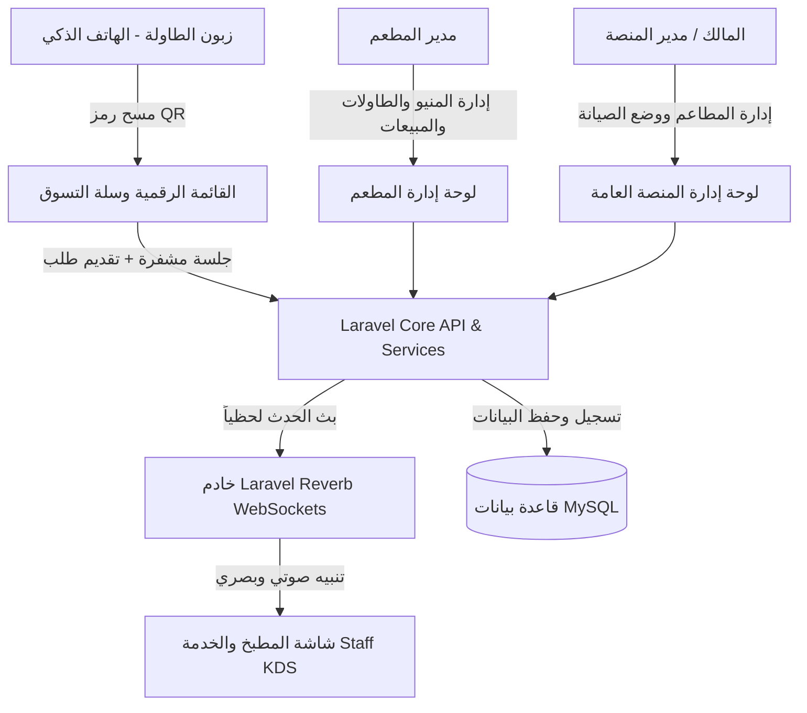

# 🌟 التقرير الشامل والمفصل لمنصة «تدلّل» (Tedallal Platform)
### الحل السحابي الرقمي المتكامل لإدارة المطاعم والطلب الذكي عبر رموز الـ QR

---

## 📌 1. نظرة عامة على المشروع (Executive Summary)

**منصة تدلّل (Tedallal)** هي منظومة سحابية متطورة مصممة للمطاعم، الكافيهات، وصالات الضيافة الحديثة بنظام **تعدد المستأجرين (Multi-Tenant SaaS)**. 
تهدف المنصة إلى إلغاء المعاناة التقليدية لانتظار قوائم الطعام الورقية أو استدعاء النادل، من خلال تمكين زبائن المطعم من تصفح قائمة الطعام التفاعلية، تخصيص وجباتهم، وتأكيد طلباتهم مباشرة من طاولاتهم عبر مسح **رمز الاستجابة السريعة (QR Code)** بكاميرا الهاتف المحمول، **دون الحاجة لتحميل أي تطبيقات أو إنشاء حسابات مسبقة**.

تتكامل تجربة الزبون اللحظية مع **شاشة مطبخ تفاعلية فورية (KDS - Kitchen Display System)** تعمل بتقنية الويب سوكت (WebSockets)، ولوحة تحكم متقدمة لإدارة المطعم، ولوحة مركزية لإدارة النظام والاشتراكات.

---

## 🏗️ 2. البنية المعمارية والتقنية (Technical Architecture & Stack)

تم بناء منصة تدلّل بأحدث المعايير البرمجية لضمان السرعة، الأمان، وقابلية التوسع الأفقي:

### ⚙️ التقنيات الأساسية (Tech Stack)
* **الواجهة الخلفية (Backend)**: إطار عمل [Laravel 12 / PHP 8.2+](file:///g:/tedallal%20كامل%20مع%20disable/tedallal/bootstrap/app.php) بالاعتماد على معمارية Modular MVC و Services Layer.
* **الواجهة الأمامية (Frontend)**: إطار عمل [Vue 3](file:///g:/tedallal%20كامل%20مع%20disable/tedallal/resources/js/app.ts) مع **Composition API** و **TypeScript** و **Inertia.js** لدمج قوة تطبيقات الصفحة الواحدة (SPA) مع أمان وإنتاجية الواجهة الخلفية بدون تعقيدات الـ REST API المنفصلة.
* **التصميم والتنسيق (Styling & Design)**: [Tailwind CSS](file:///g:/tedallal%20كامل%20مع%20disable/tedallal/tailwind.config.js) بنظام ألوان عصري مستوحى من الضيافة الدافئة (Amber & Warm Stone) وتصميم متجاوب 100% مع كافة الشاشات وأجهزة الجوال.
* **المحرك اللحظي (Realtime Engine)**: [Laravel Reverb](file:///g:/tedallal%20كامل%20مع%20disable/tedallal/config/reverb.php) عبر خادم WebSockets محلي فائق السرعة لدفع الطلبات وتحديثات الحالات لحظياً دون الحاجة لإعادة تحميل الصفحة (Zero Polling).
* **إدارة الصلاحيات والأمان**: حزمة [Spatie Laravel Permission](file:///g:/tedallal%20كامل%20مع%20disable/tedallal/config/permission.php) للتحكم الدقيق في الأدوار والصلاحيات (RBAC).
* **قاعدة البيانات**: MySQL / MariaDB مدعومة بنظام الفهارس المحسنة والمعاملات المصرفية الآمنة (`DB Transactions`).
* **الرسوم البيانية والإحصاءات**: مكتبة `Chart.js` ومكونات `vue-chartjs` لعرض الرسوم البيانية التفاعلية.

---

## 👥 3. هرمية الأدوار والممثلون في النظام (User Roles & Permissions)

| الدور (Role) | نطاق الصلاحيات | طريقة الدخول | الوظيفة الأساسية |
| :--- | :--- | :--- | :--- |
| **الزبون (Customer)** | طاولة محددة | مسح رمز QR للطاولة | تصفح المنيو، إضافة الطلبات، تخصيص الملاحظات، متابعة حالة الطلب. |
| **طاقم المطبخ والخدمة (Staff)** | مطعمه فقط | بريد إلكتروني + كلمة مرور | استلام الطلبات لحظياً، تغيير حالة الوجبات (تحضير، جاهز، تقديم)، طباعة تذاكر المطبخ. |
| **مدير المطعم (Restaurant Admin)** | كامل مطعمه | بريد إلكتروني + كلمة مرور | إدارة المنيو، توليد وطباعة رموز QR للطاولات، إدارة الموظفين، العروض، التحليلات، وإعدادات الهوية. |
| **مدير النظام (System Admin)** | كامل المنصة | بريد إلكتروني + كلمة مرور | استعراض إحصائيات كافة المطاعم، إنشاء مطاعم جديدة، تفعيل وتعطيل الميزات الإضافية. |
| **المالك الرئيسي (Super Admin Owner)** | النظام بأكمله | بريد إلكتروني حصري | كافة صلاحيات مدير النظام + **الصلاحية الحصرية لإيقاف وتشغيل وضع الصيانة للمنصة مع تجاوزه**. |

---

## 💎 4. المزايا التفصيلية للمنصة (Detailed Features & Modules)

### 📱 أولاً: تجربة الزبون والقائمة التفاعلية (Customer Experience)
1. **طلب فوري بدون تطبيقات أو تسجيل حساب**:
   - يدخل الزبون عبر رابط آمن مشفر مرتبط بالطاولة تلقائياً (`/t/{public_token}`).
   - يتم إنشاء جلسة طاولة آمنة (`TableSession`) تحفظ سلة المشتريات حتى لو أعاد تحميل الصفحة.
2. **سلة عائمة عصرية وأنيقة (Floating Cart Bar)**:
   - سلة عائمة أسفل الشاشة بتصميم زجاجي داكن (`Glassmorphism`) وحواف منحنية راقية.
   - حقيبة تسوق مضيئة مع شارة نابضة بحركة اهتزاز لطيفة (`Bounce Animation`) تعرض عدد الأصناف لحظياً.
   - عرض فوري لإجمالي الفاتورة مع العملة المحلية المعتمدة للمطعم.
   - **لا تحجب المنيو**: لا تفتح السلة الكبيرة إلا عند رغبة الزبون بالضغط على الشريط، مما يتيح له إضافة أصناف متعددة بسلاسة وبدون أي انقطاع.
3. **عداد فوري في نفس بطاقة الصنف (In-Card Stepper & Quick Add)**:
   - زر `+` مباشر لإضافة الصنف بلمسة واحدة.
   - بمجرد إضافة الصنف، يتحول الزر تلقائياً إلى عداد فوري `[ − ] [ 2 ] [ + ]` يتيح للزبون زيادة أو إنقاص الكمية دون فتح أي نافذة.
   - شارة عدد واضحة على زاوية صورة الصنف.
4. **تخصيص الوجبات والملاحظات الدقيقة**:
   - إمكانية كتابة ملاحظة خاصة لكل صنف على حدة (مثل: "بدون ثوم"، "زيادة حدة").
   - كتابة ملاحظة عامة على الطلب ككل (مثل: "يرجى الاستعجال"، "تقديم المقبلات أولاً").
5. **محرك العروض وأكواد الخصم (Promo Codes Engine)**:
   - إمكانية إدخال كود ترويجي والتحقق اللحظي من صلاحيته وقيمة الخصم (نسبة مئوية أو مبلغ ثابت).
6. **تجميد الأسعار الفوري (Price Snapshot Guarantee)**:
   - فور إرسال الطلب، يتم حفظ لقطة غير قابلة للتغيير لسعر واسم كل صنف في لحظة الشراء لحماية حقوق الزبون والمطعم من أي تعديل لاحق للأسعار.
7. **شاشة تتبع الطلب المباشرة (Live Order Tracking)**:
   - شاشة تفاعلية تتيح للزبون معرفة مرحلة طلبه خطوة بخطوة (قيد الانتظار ⏳ -> قيد التحضير 👨‍🍳 -> جاهز للتقديم 🍽️ -> تم التقديم ✅) مع تحديث فوري عبر الويب سوكت.

---

### 👨‍🍳 ثانياً: شاشة المطبخ والطلبات الحية (Kitchen Display System - KDS)
1. **لوحة كانبان تفاعلية (Kanban Board)**:
   - تقسيم بصري منظم لأعمدة العمل: `جديد (Pending)`، `قيد التحضير (Preparing)`، `جاهز للتقديم (Ready)`، `تم التقديم (Served)`.
   - إمكانية نقل الطلبات بالسحب والإفلات (`Drag & Drop`) أو عبر النقر السلس على أزرار الترقية السريعة.
2. **تنبيهات صوتية وبصرية فورية**:
   - إطلاق نغمة تنبيه صوتية باستخدام (Web Audio API Synthesizer) لحظة وصول أي طلب جديد للمطبخ.
   - إشعارات متصفح سطح المكتب (`Browser Push Notifications`) تتضمن رقم الطاولة وملاحظات الزبون.
3. **إبراز ملاحظات الزبائن بشكل احترافي**:
   - بطاقة بارزة بلون كهرماني لملاحظة الطلب العامة.
   - شارات بارزة باللون البرتقالي تحت كل صنف توضح رغبات الزبون الخاصة لتفادي أخطاء الطهي.
   - وسم تنبيهي فوق قائمة الأصناف يوضح وجود ملاحظات خاصة في هذا الطلب.
4. **مؤقت ذكي لزمن الانتظار (Elapsed Time Tracker)**:
   - شارة ذكية تحسب زمن انتظار الطلب بالدقائق وتتغير ألوانها ديناميكياً (أخضر -> أصفر -> أحمر) لتنبيه الشيف بالطلبات المتأخرة.
5. **زر طباعة تذكرة وفاتورة المطبخ**:
   - زر مدمج في كل بطاقة لطباعة إيصال الطلب على الطابعات الحرارية بضغطة زر واحدة.

---

### 📊 ثالثاً: لوحة إدارة المطعم (Restaurant Admin Panel)
1. **لوحة مؤشرات الأداء الحية**:
   - استعراض فوري لإجمالي مبيعات اليوم، عدد الطلبات النشطة، ومتوسط قيمة الفاتورة.
2. **إدارة قائمة الطعام (Menu Engineering)**:
   - إضافة وتعديل التصنيفات مع إمكانية الترتيب بالسحب والإفلات.
   - إدارة الأصناف، رفع الصور المحسنة، تحديد الأسعار، وزر فوري لتعطيل توفر الصنف (`Available / Out of Stock`) بلمسة واحدة.
3. **نظام إدارة الطاولات وتوليد الـ QR**:
   - إضافة وحذف الطاولات وتسميتها.
   - **توليد رموز الـ QR الآلي والفوري**: توليد صور QR عالية الجودة لكل طاولة جديدة تلقائياً.
   - **إعادة ضبط الرمز للأمان (Regenerate QR)**: في حال أراد المطعم إلغاء الرمز القديم لأسباب أمنية، يمكنه توليد رمز وتوكن جديد بنقرة واحدة دون التأثير على الطلبات السابقة.
   - **طباعة مجمعة أنيقة لبطاقات الطاولات (`Table Print View`)**: صفحة مخصصة لطباعة بطاقات الـ QR بتنسيق شبكي جاهز للقص والتثبيت على الطاولات.
4. **طباعة الفواتير الحرارية المعيارية (80mm Thermal Receipts)**:
   - تصميم فاتورة حرارية مخصص ومحكم بمقاس 80 ملم، يتضمن اسم المطعم، رقم الطاولة، التاريخ والتوقيت، تفاصيل الأصناف وملاحظاتها، المجموع، والعملة المحلية.
5. **إدارة طاقم العمل وتوزيع الصلاحيات**:
   - إنشاء حسابات للموظفين (كاشير، نادل، شيف).
   - تفعيل وتعطيل الحسابات بضغطة زر، وتحديد الصلاحيات الدقيقة لكل موظف.
6. **إدارة العروض والخصومات**:
   - إنشاء أكواد ترويجية مع تحديد تاريخ البداية والنهاية والحد الأدنى للطلب.
7. **تخصيص الهوية البصرية وإعدادات المطعم**:
   - تعديل الاسم، العنوان، رقم الهاتف، العملة، اللوجو، والصورة البانورامية لقائمة الطعام.

---

### 📈 رابعاً: مركز التحليلات الذكية (Smart Analytics & Business Intelligence)
1. **تحليلات تفاعلية بيانية (Interactive Charts)**:
   - **مخطط أوقات الذروة (Peak Hours)**: رسم بياني يوضح ساعات الذروة وتوزيع الطلبات على مدار اليوم لتوزيع ورديات العمل بكفاءة.
   - **توزيع المبيعات حسب الأقسام (Sales by Category)**: مخطط دائري يوضح التصنيفات الأكثر ربحية في المطعم.
2. **تحليل أداء الطاولات والمنتجات**:
   - جدول الطاولات الأكثر نشاطاً ومبيعاً.
   - قائمة الوجبات الأكثر مبيعاً (Top Sellers) والأصناف الراكدة الأقل طلباً لدعم اتخاذ القرارات التسويقية.
3. **المقترحات الذكية (Rule-based Insights)**:
   - خوارزمية ذكية تحلل مؤشرات المطعم وتقدم نصائح عملية للإدارة (مثل التنبيه لارتفاع نسبة الإلغاء، أو اقتراح عروض للأصناف الراكدة).

---

### 🏢 خامساً: لوحة تحكم المنصة المركزية وإدارة الاشتراكات (Super Admin Portal)
1. **إدارة المطاعم متعددة المستأجرين (Multi-Tenancy Management)**:
   - إنشاء وتفعيل المطاعم وإدارتها من لوحة واحدة.
   - استعراض إجمالي مبيعات ومستخدمي وطلبات المنصة بالكامل.
2. **نظام الإضافات والتحكم بالميزات (Modular Add-ons System)**:
   - إمكانية تفعيل أو قفل الميزات لكل مطعم على حدة (مثل باقة تتضمن "التحليلات المتقدمة" وباقة لا تتضمنها).
   - شاشة قفل ذكية تظهر لمدير المطعم عند محاولة الوصول لميزة غير مفعلة في اشتراكه تدعوه لترقية باقته.
3. **نظام وضع الصيانة المركزي الحصري (Maintenance Mode with Owner Bypass)**:
   - محمي بصلاحية حصرية للمالك الرئيسي (`super@tedallal.test`)، ومحجوب تماماً عن بقية المدراء.
   - في حال تفعيل وضع الصيانة، تظهر صفحة صيانة مخصصة وأنيقة لجميع الزوار والمطاعم، مع **تجاوز تلقائي لحساب المالك** ليتسنى له فحص وتحديث النظام دون انقطاع.

---

## 🔒 5. معايير الأمان وعزل البيانات (Security & Reliability)

1. **عزل المستأجرين (Strict Tenant Isolation)**:
   - جميع استعلامات قاعدة البيانات محمية عبر `TenantScope` و `HasTenant Trait` لضمان استحالة وصول أي مطعم لبيانات مطعم آخر.
2. **جلسات الطاولات المشفرة (Secure Tokenized Sessions)**:
   - لا يتم كشف المعرفات الداخلية للطاولات، بل يتم استخدام رموز توكن مشفرة وطويلة (`public_token`).
3. **حماية العمليات المالية**:
   - حساب العمليات ومجاميع السلة يتم حصرياً في خادم الواجهة الخلفية عبر فئة محاسبية مخصصة (`MoneyCalculator`) لمنع أي تلاعب بالأسعار من طرف المتصفح.
4. **حماية CSRF والأمان الشبكي**:
   - حماية كاملة ضد هجمات تزوير الطلبات عبر المواقع (CSRF)، وحقن الاستعلامات (SQL Injection)، وهجمات Cross-Site Scripting (XSS).

---

## 🚀 6. البنية التحتية والنشر الآلي (DevOps & Deployment Architecture)

* **سيرفر الإنتاج الحي**: خادم سحابي عالي الأداء (Linux Ubuntu VPS) على العنوان `tedallal.omarkhateeb.com`.
* **مخدم الويب**: Nginx مُهيّأ بحزم ضغط متقدمة وتوجيه الـ SSL والويب سوكت.
* **نظام النشر الآلي بدون توقف (Zero-Downtime Deployment)**:
  - ربط المستودع بنظام Git Hooks متقدم عبر السيرفر.
  - بمجرد تشغيل الأمر `git push vps main`، يقوم السيرفر تلقائياً بتنفيذ:
    1. تفعيل وضع الصيانة المؤقت.
    2. تحديث الشيفرة البرمجية.
    3. تثبيت حزم PHP والاعتماديات.
    4. بناء أصول الواجهة الحديثة عبر Vite (`npm run build`).
    5. تشغيل مايجريشن قاعدة البيانات (`migrate --force`).
    6. تحديث وتفريغ الكاش (`optimize:clear` و `config:cache` و `route:cache`).
    7. إعادة تشغيل عمليات الخلفية (`queue:restart` و `reverb`).
    8. إعادة تحميل PHP-FPM وإلغاء الصيانة.

---

## 🎯 7. خلاصة القيمة المضافة (Value Proposition)

| للمطعم والإدارة | للمطبخ وطاقم الخدمة | للزبون والزائر |
| :--- | :--- | :--- |
| 💰 زيادة المبيعات وسرعة دوران الطاولات بنسبة تصل إلى 30%. | 👨‍🍳 تنظيم استلام الطلبات وتقليل الأخطاء البشرية بنسبة 95%. | ⏱️ راحة تامة والطلب خلال ثوانٍ معدودة دون انتظار. |
| 📉 توفير تكاليف طباعة القوائم الورقية عند تغيير الأصناف أو الأسعار. | 🔔 تنبيهات فورية صوتية وبصرية ومؤقت زمني لحرق الطلبات. | 📝 دقة تامة في تخصيص الوجبات والملاحظات والمقبلات. |
| 📊 تقارير وقرارات مبنية على بيانات دقيقة وأوقات ذروة حقيقية. | 📱 تخلص كامل من فوضى الأوراق وتشتت الندلاء. | 💳 شفافية تامة في الأسعار والخصومات وتتبع الوجبة لحظياً. |
